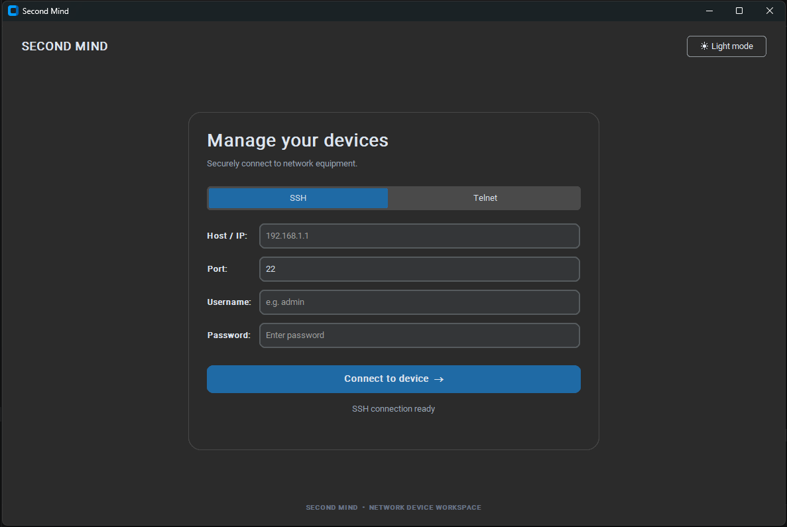
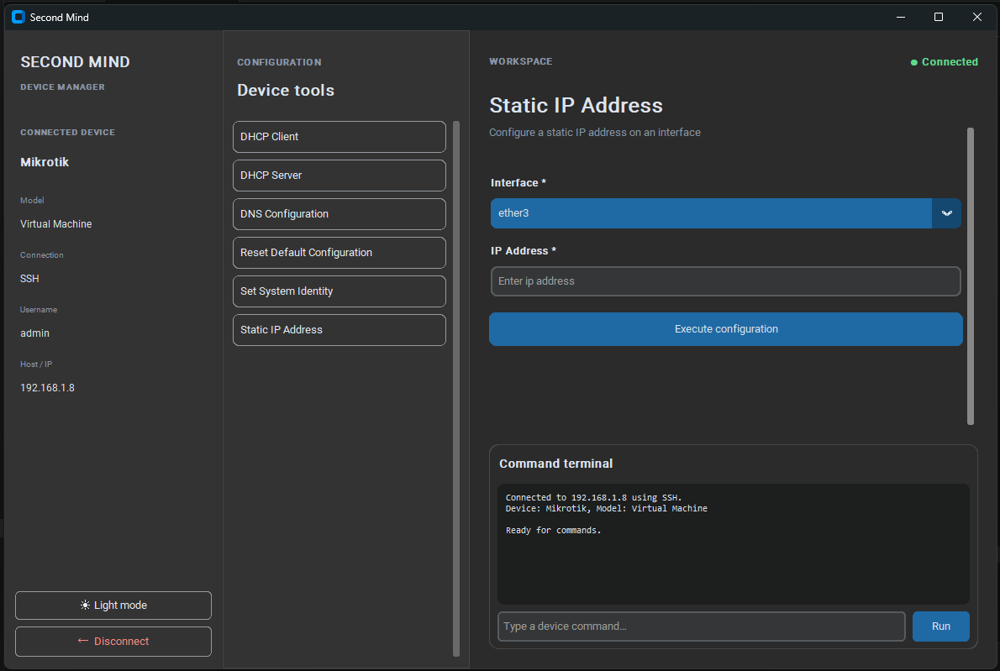
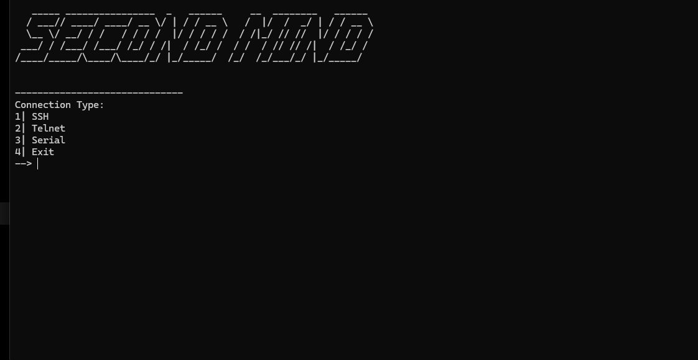

<!-- ## 📸 Screenshots

 -->


<div align="center">

# ⚡ Second Mind

### Network Device Configuration.

A Python-based network management tool for MikroTik and Cisco devices, featuring both graphical and command-line interfaces.

[📥 Download](#-download) · [✨ Features](#-features) · [🛠️ Installation](#️-installation)
</div>


## 📸 Screenshots

<div align="center">

<table>
  <tr>
    <td align="center">
      
      <br>
    <b>Connection Interface</b>
    </td>
    <td align="center">
      
      <br>
        <b>Main Workspace</b>
    </td>
  </tr>
  <tr>
    <td colspan="2" align="center">
      
      <br>
      <b>Configuration & Command Terminal</b>
    </td>
  </tr>
</table>

</div>

## ✨ Features

- 🖥️ **Dual Interface** — Graphical (GUI) and Command-Line (CLI) modes.
- 🔌 **SSH and Telnet Connectivity** — Remotely connect to network devices.
- 🌐 **Multi-Vendor Support** — MikroTik and Cisco devices.
- ⚙️ **Dynamic Configuration System** — JSON-based configuration templates.
- 🚀 **Automatic Command Generation** — Generate device-specific commands from user inputs.
- 🔍 **Device Detection** — Automatically identify connected devices.
- 📡 **Interface Detection** — Retrieve available network interfaces from connected devices.
- 💻 **Built-in Terminal** — Execute commands directly on connected devices.
- 🎨 **Modern GUI** — Dark and light themes with a responsive workspace.

## 🖥️ Interfaces

### Graphical User Interface (GUI)

A modern desktop interface built with CustomTkinter.

- Device connection management
- Dynamic configuration forms
- Automatic interface selection
- Command preview and execution confirmation
- Built-in command terminal
- Dark and light appearance modes

### Command-Line Interface (CLI)

A terminal-based interface for direct interaction with network devices.

- Interactive connection
- Device identification
- Configuration menus
- Direct command execution

## 🌐 Supported Devices & Configurations

### MikroTik

- Static IP Address
- DHCP Client
- DHCP Server
- DNS
- System Identity
- Reset Default Configuration

### Cisco

- VLAN Creation
- Access Port Configuration
- Trunk Port Configuration
- Allowed VLAN Configuration
- EtherChannel
- Interface IP Configuration
- Static Routing
- Default Routing
- Hostname Configuration

*Configuration availability may vary between interfaces.*

---

## 📥 Download

**Get the latest version of Second Mind for Windows.**

Visit the [Releases](https://github.com/shahinvaseghi/Second-mind/releases) page to download the latest executable.

1. Download the latest Windows release.
2. Extract the downloaded archive if necessary.
3. Run the application.
4. Connect to your network device and start configuring.

> No Python installation or manual dependency setup is required when using the packaged executable.

---

## 🛠️ Installation

If you want to run the project from source:

**1. Clone the repository**

```bash
git clone https://github.com/shahinvaseghi/Second-mind.git
cd Second-mind
```

**2. Install dependencies**

```bash
pip install -r requirements.txt
```

**3. Run the GUI**

```bash
python second-mind.py
```

**4. Run the CLI**

```bash
python "second-mind(CLI).py"
```

---

## 📁 Project Structure

```text
Second-Mind/
│
├── Database/
│   ├── Cisco/
│   └── MikroTik/
│
├── utils/
│   ├── config_manager.py
│   └── Connection.py
│
├── src/
│   └── screenshots/
│
├── second-mind.py
├── second-mind(CLI).py
├── requirements.txt
├── .gitignore
└── README.md
```

## 🤝 Contributing

Contributions, suggestions, and ideas are always welcome.

## 📄 License

No license has been specified yet.

---

<div align="center">

**⚡ Second Mind**

</div>
